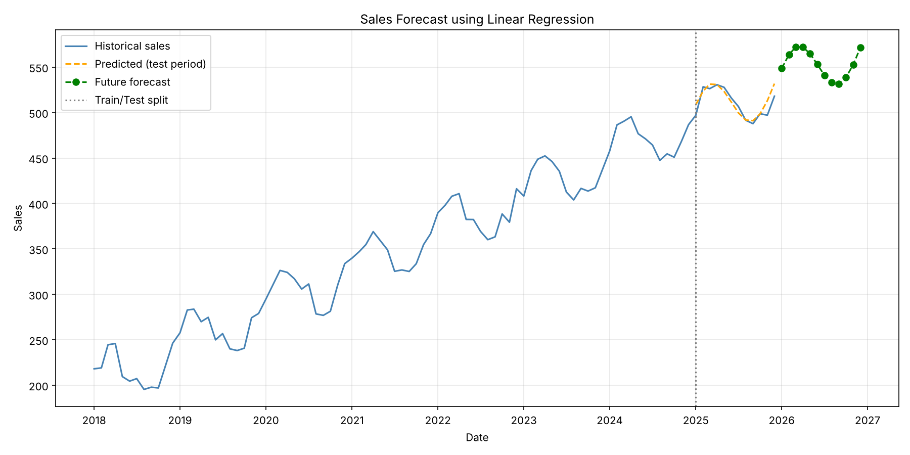

# Predictive Analytics Using Historical Data

A predictive model that forecasts future sales trends from historical monthly data.

## Features
- Cleans and preprocesses historical data (duplicates, sorting, missing-value interpolation)
- Linear Regression with time-trend and seasonal (month) features
- Evaluates accuracy with MAE, RMSE and R² on a time-based test split
- Forecasts the next 12 months and saves a visualization

## Project Structure
```
predict.py          # main script
requirements.txt    # dependencies
sales_data.csv      # dataset (auto-generated if missing; replace with your own)
forecast.csv        # output: 12-month forecast
forecast_plot.png   # output: chart
```

## How to Run
```bash
pip install -r requirements.txt
python predict.py
```

To use your own data, provide `sales_data.csv` with columns `date` and `sales`.

## Results
On the test set (last 12 months): MAE ≈ 5.94, RMSE ≈ 7.80, R² ≈ 0.73.



## Tech Stack
Python, pandas, NumPy, scikit-learn, Matplotlib
